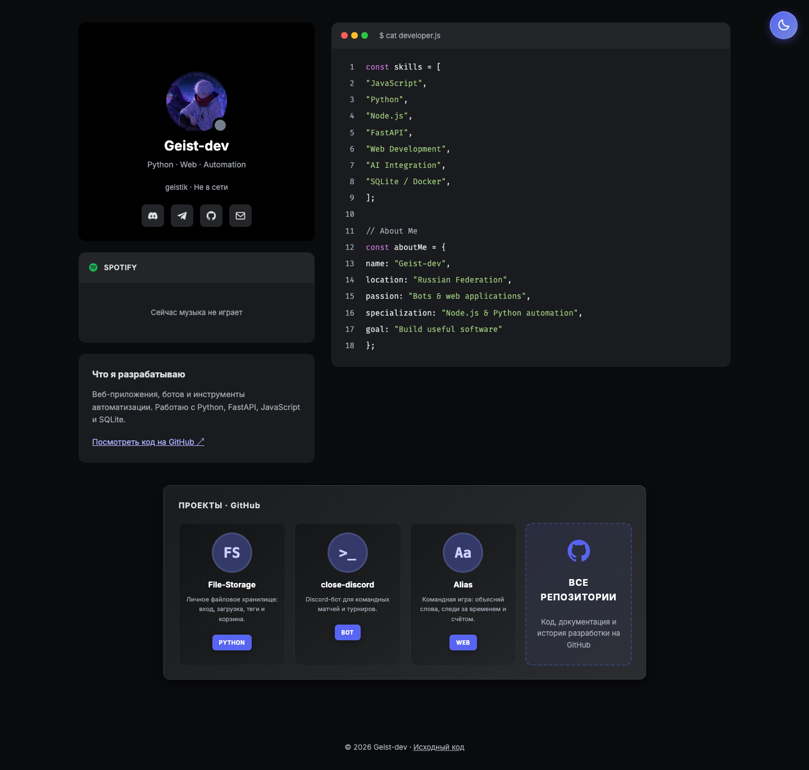
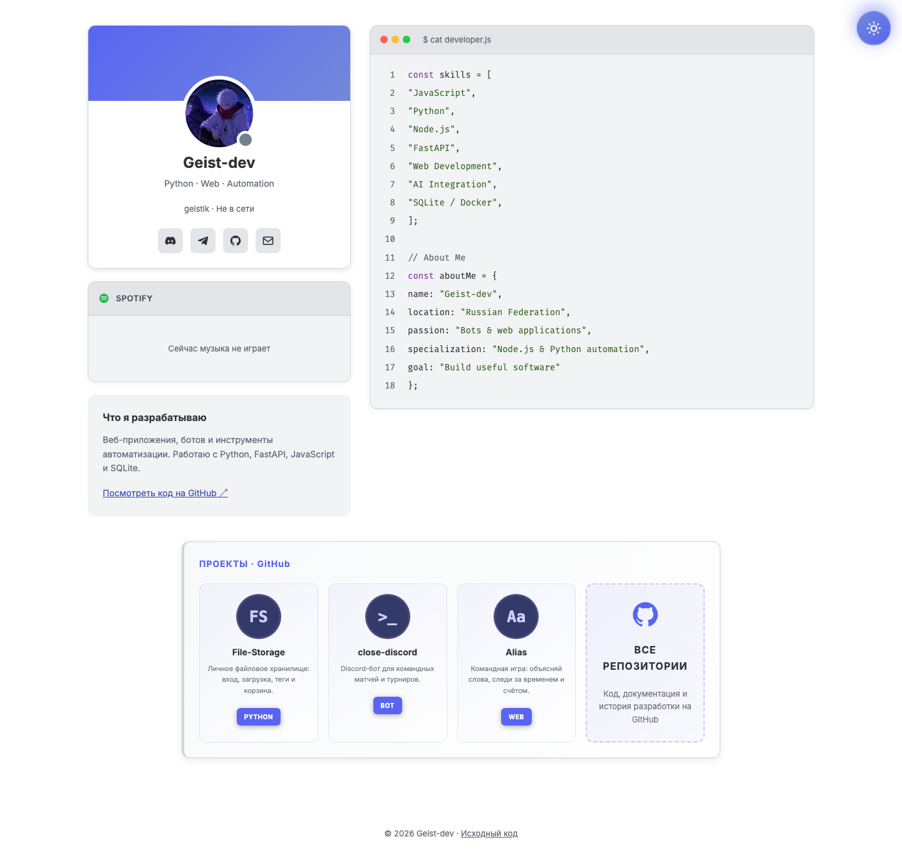
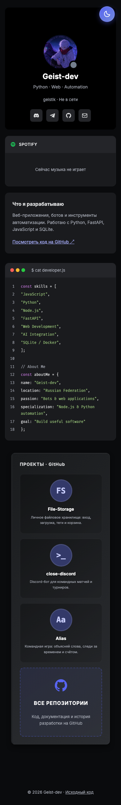

# Geist-dev · Developer Portfolio

Персональное портфолио в стиле Discord: проекты с открытым кодом, стек, контакты, живой статус и музыка Spotify через Lanyard. HTML, CSS, JavaScript и небольшой сервер Express — без сборщика и обязательных ключей API.

[GitHub автора](https://github.com/Geist-dev) · [Telegram](https://t.me/flipgood) · [Почта](mailto:aeromax.live@mail.ru) · [MIT](LICENSE)

## Как выглядит

Снимки сделаны с работающего локального сайта. Discord и Spotify показывают состояние на момент съёмки; оно может меняться.



<details>
<summary>Светлая тема и мобильная версия</summary>





</details>

## Возможности

- Карточки File-Storage, close-discord и Alias со ссылками на исходники.
- Контакты Geist-dev: GitHub, Telegram, почта и Discord.
- Тёмная и светлая темы с сохранением выбора, если браузер разрешает localStorage.
- Статус Discord, текущая музыка Spotify и активность через публичный Lanyard API.
- Отдельное состояние ошибки сервиса: сайт остаётся доступным, а старые активности исчезают.
- Локальные шрифты и иконки; доступная навигация с клавиатуры, поддержка reduced motion.
- Базовый контент и ссылки работают без JavaScript.

## Вариант 1 · Пошаговый запуск

1. Установите [Node.js](https://nodejs.org/) **22.9+ в ветке 22 либо 24** вместе с npm. Git понадобится для клонирования. Проверка:

   ```bash
   node --version
   npm --version
   git --version
   ```

2. Скачайте проект и перейдите в его папку:

   ```bash
   git clone https://github.com/Geist-dev/geist-discord.github.io.git
   cd geist-discord.github.io
   ```

3. Установите зависимости из lockfile:

   ```bash
   npm ci
   ```

4. Запустите сайт:

   ```bash
   npm start
   ```

5. Откройте **http://127.0.0.1:3000**. Остановить сервер можно сочетанием `Ctrl+C`.

Эти команды работают в macOS, Linux и Windows PowerShell. Для разработки с перезапуском сервера при изменении файлов: `npm run dev`; страницу обновляйте в браузере.

## Вариант 2 · Одна команда

В скачанной папке проекта выполните:

```bash
bash start.sh
```

Скрипт проверяет Node.js и npm, устанавливает зависимости через `npm ci` и запускает сервер. Откройте **http://127.0.0.1:3000**. Нужны установленный Node.js и интернет для первой установки пакетов. В Windows используйте Git Bash или WSL; в PowerShell доступен пошаговый вариант выше. Скрипт остаётся в терминале до `Ctrl+C`, браузер автоматически не открывается.

## Настройка

Без `.env` сайт работает на `127.0.0.1:3000`. Необязательные переменные:

| Переменная | По умолчанию | Назначение |
| --- | --- | --- |
| `HOST` | `127.0.0.1` | Адрес прослушивания; `0.0.0.0` для доступа из сети |
| `PORT` | `3000` | Порт сервера |
| `DISCORD_ID` | `config.json` | Публичный Discord ID; пустое значение отключает интеграцию на Node-сервере |

Скопируйте `.env.example` в `.env` и измените нужные поля. В macOS/Linux: `cp .env.example .env`; в PowerShell: `Copy-Item .env.example .env`. `.env` исключён из Git. Для доступа с телефона в своей сети укажите `HOST=0.0.0.0` и откройте `http://IP-КОМПЬЮТЕРА:3000`; проверьте доступность порта в локальном брандмауэре.

### Discord и Spotify

Токен Discord-бота, пароль и OAuth-секрет **не нужны**. Используется только публичный ID `601356351263997952`. Чтобы Lanyard мог показывать состояние аккаунта, аккаунт должен быть подключён к сервису; условия и настройка описаны в [документации Lanyard](https://github.com/Phineas/lanyard#readme). Наличие Spotify в ответе зависит от настроек и текущей активности аккаунта.

На Node-сервере `/api/discord` обращается к Lanyard с тайм-аутом 5 секунд, объединяет одновременные запросы и кэширует результат на 15 секунд. Браузер обновляет данные раз в 15 секунд, пока вкладка видима. Это периодическое обновление, а не поток в реальном времени.

Для другого аккаунта измените `discord_id` в `config.json`, метатег `discord-id` в `index.html` и ссылку Discord в той же странице. При отключении интеграции удалите также ссылку и очистите метатег, если публикуете статическую версию. Основное имя портфолио остаётся Geist-dev независимо от ника Discord.

### GitHub Pages и другой статический хостинг

HTML и ресурсы работают без Node. На статическом хостинге запрос `api/discord` вернёт 404, после чего браузер обращается прямо к публичному Lanyard API с ID из метатега `discord-id`. Доступность статуса зависит от Lanyard и его CORS. `.env` и `server.js` на GitHub Pages не исполняются.

Публикуйте только публичные файлы: `index.html`, `app.js`, `styles/`, `assets/` и `шрифты/`; при распространении сохраняйте `LICENSE`, `THIRD_PARTY_NOTICES.md` и `licenses/`. Проверка статического режима включена в браузерный тест. Настройки GitHub Pages этим изменением не переключаются.

## Где менять контент

| Файл | Что менять |
| --- | --- |
| `index.html` | Имя, контакты, стек, карточки проектов, Discord ID для статического сайта |
| `styles/main.css` | Темы, расположение карточек, адаптивность |
| `styles/fonts.css` | Локальные шрифты |
| `app.js` | Переключение тем, безопасный вывод данных и обновление статуса |
| `config.json` | Публичный Discord ID для Node-сервера |
| `presence.js` | Lanyard, тайм-аут, кэш и обработка ошибок |
| `server.js` | Публичные маршруты, HTTP-заголовки и запуск |

Сервер раздаёт только перечисленные публичные ресурсы; служебные файлы и зависимости недоступны по HTTP. Поля активности и треков вставляются через `textContent`, без исполнения HTML. Сценарии блокировки копирования и инструментов разработчика удалены.

## Проверки

```bash
npm test
npm run check
bash -n start.sh
```

11 тестов проверяют HTTP-маршруты, служебные файлы, заголовки, конфигурацию, кэш, одновременные запросы и ошибки Lanyard. Тесты используют подставной ответ API, поэтому не зависят от текущего статуса аккаунта.

Для браузерной проверки запустите сайт, а в другом терминале установите Python 3.10+ с Playwright и выполните:

```bash
python3 -m venv .venv
source .venv/bin/activate
python -m pip install playwright==1.58.0
python -m playwright install chromium
python tests/browser_smoke.py
```

В Windows команда активации окружения: `.venv\Scripts\Activate.ps1`. Проверяются контакты, локальные шрифты, HTML в данных API, сохранение темы, недоступность localStorage, ошибки Discord, статический режим и ширины 320/390/768/1440. GitHub Actions выполняет серверные тесты на Node.js 22 и 24 и браузерную проверку Chromium.

## Лицензия и авторство

Код проекта — [MIT](LICENSE), правообладатель **Geist-dev**. Разрешены использование, изменение и распространение, в том числе коммерческое, при сохранении уведомления об авторстве и текста лицензии в копиях или существенных частях кода. MIT не требует отдельной подписи в интерфейсе каждого производного сайта.

Встроенные шрифты сохраняют лицензии своих авторов: [сторонние материалы](THIRD_PARTY_NOTICES.md). Дизайн вдохновлён Discord; сайт не связан с компанией Discord.
